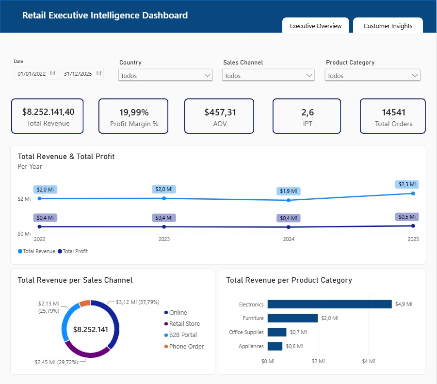
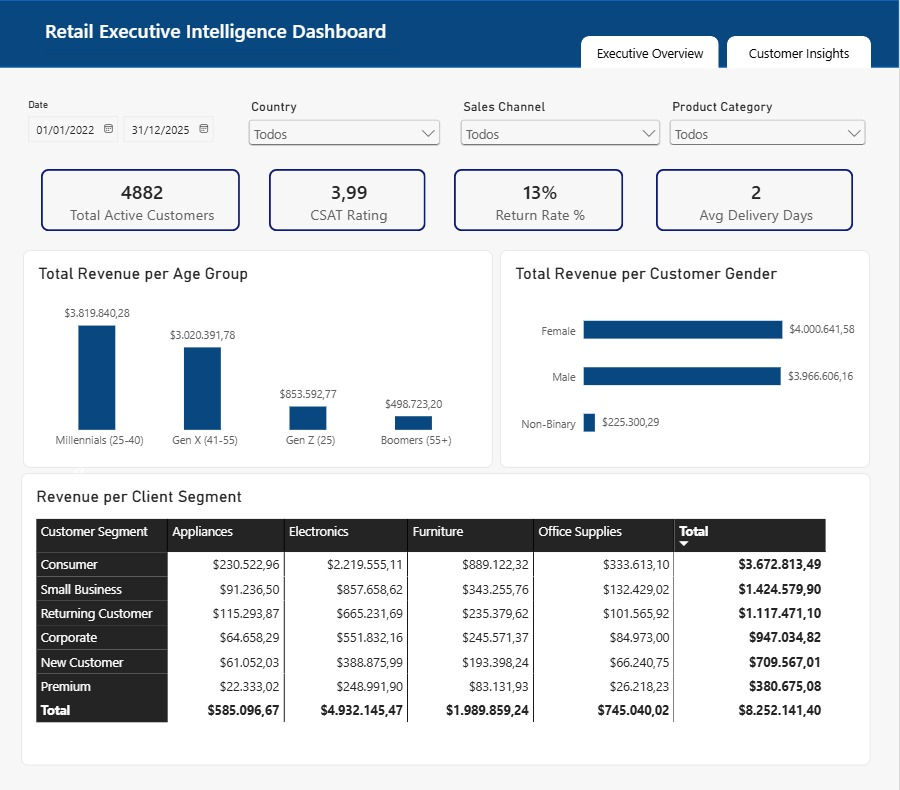

# 🛒 Global Retail Performance & Customer Insights Analytics

An end-to-end retail business intelligence project leveraging **Google BigQuery SQL**, **Power BI (DAX)**, and **Figma UI/UX Prototyping** to evaluate sales revenue, profit margins, discount impact, and customer demographics for an omnichannel retail brand. 

The original dataset can be found here: https://www.kaggle.com/datasets/danielsowah123/retail-sales-dataset?select=sales_data_dictionary.csv

---

## 📌 Project Overview

The objective of this project is to simulate an enterprise-grade retail analytics solution. It provides C-Level executives and category managers with actionable insights into revenue streams, product category performance, promotional discount impacts, and customer purchasing patterns.

 ### Key Business Questions Addressed:  
 * What is the overall financial health of the business (Revenue, Profit, AOV, IPT, Margin %)?  
 * Which product categories generate the highest revenue share, and which rely too heavily on discounts?  
 * How do promotional discounts affect net profit margins ( *Markdown Analysis*)?  
 * What are the demographic profiles (generations & gender) driving higher basket sizes?  * What are the primary root causes behind product returns? 

---

## 🛠️ Tech Stack & Skills Demonstrated 
* **Database  Querying:** Google BigQuery (SQL aggregate functions, Window Functions, `DATE_TRUNC`, CTEs). 
* **UI/UX Prototyping:** Figma. 
* **Business Intelligence  Data Modeling:** Power BI Desktop, Star Schema (`d_Calendar`), DAX measures. 
* **Key Retail KPIs:** Total Revenue, Profit Margin %, AOV (Average Order Value), IPT (Items Per Transaction), MoM Growth %, Return Rate %. 

---

## 📊 Dashboard Architecture  Key Pages 

### 📄 Page 1: Executive Overview  Financial Performance 
* **Top KPI Scorecard:** Revenue ($), Profit ($), Profit Margin %, AOV, IPT, and MoM Growth %. 
* **Revenue Share by Category:** Horizontal bar chart with drill-down to subcategories. 
* **Channel Distribution:** Donut chart breaking down Online vs. In-Store performance. 


### 📄 Page 2: Customer Demographics  Operational Insights 
* **Operational KPIs:** Active Customers, CSAT Rating, Return Rate %, and Avg Delivery Days. 
* **Demographic Breakdown:** Revenue and AOV segmented by generational cohorts (*Gen Z, Millennials, Gen X, Boomers*) and gender. 
* **Customer Segment Heatmap:** Cross-tabulation of customer lifecycle segments against product categories. 

---

## 🧮 Key DAX Measures Used 

```dax 
// Total Revenue 
Total Revenue = SUM(retail_sales[Sales_Amount])

// Profit Margin % 
Profit Margin % = DIVIDE([Total Profit], [Total Revenue], 0)

// Average Order Value (AOV) 
AOV = DIVIDE([Total Revenue], [Total Orders], 0)

// Items Per Transaction (IPT) 
IPT = DIVIDE([Total Units Sold], [Total Orders], 0) 

// Return Rate % 
Return Rate % = VAR TotalOrdersCount = [Total Orders] VAR ReturnedOrdersCount = CALCULATE([Total Orders], retail_sales[Return_Flag] = TRUE) RETURN DIVIDE(ReturnedOrdersCount, TotalOrdersCount, 0)
